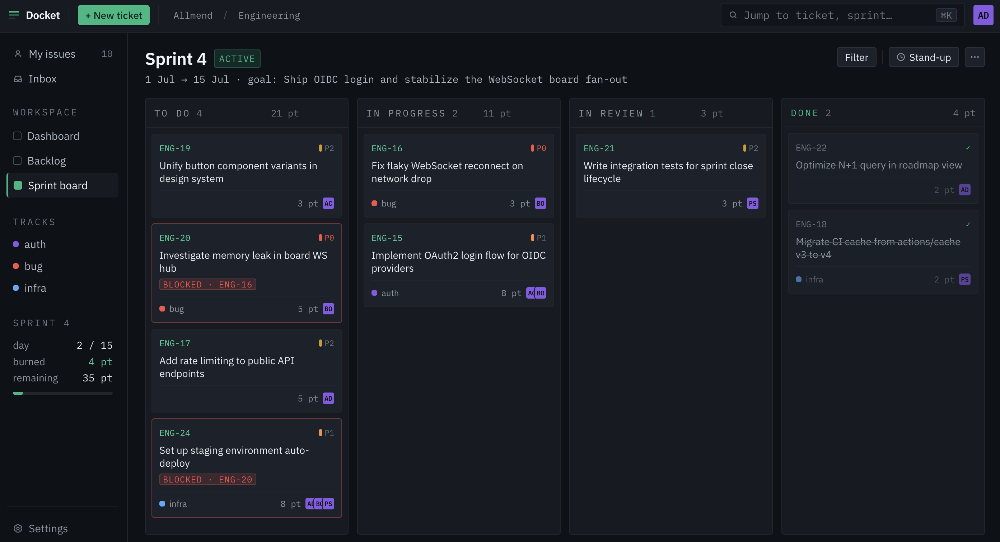

<p align="center">
  <picture>
    <source media="(prefers-color-scheme: dark)" srcset="docs/assets/docket-wordmark-dark.svg">
    
  </picture>
</p>

<p align="center"><sub>Made in Sweden 🇸🇪 with Claude &amp; Love</sub></p>

<p align="center">
  <a href="https://github.com/allmend/docket/releases"></a>
  <a href="https://github.com/allmend/docket/actions"></a>
  <a href="LICENSE"></a>
  
</p>

> ⚠️ **Alpha.** The full Scrum workflow works. Expect bugs, missing features, and breaking changes. Not production-ready yet — feedback welcome.

Docket is a lightweight, self-hostable Scrum-first ticket and task management tool for engineering teams. An open-source alternative to Linear, Jira, and Shortcut — built close to the Scrum Guide, without the billion settings.

Part of the [Allmend](https://github.com/allmend) suite of open-source tools.



---

## Features

- Teams, boards, and tickets with display IDs (`ENG-42`)
- Kanban and Scrum board modes
- Sprint lifecycle — planning, active, close with Sprint Goal
- Product backlog with drag-to-reorder and bulk sprint assignment
- Sprint capacity — team capacity in story points with a committed-vs-capacity bar on planning, plus per-member focus percentage
- Roadmap — all sprints with progress bars and ticket lists
- Daily Scrum view — active sprint tickets grouped by assignee, with search and filter
- Backlog refinement view — side-by-side ticket list and detail, arrow key navigation, readiness indicator
- Definition of Done — board-level checklist with per-ticket check state
- Acceptance criteria with interactive checkboxes
- Story points
- Ticket detail with inline editing, Markdown support, and syntax highlighting
- Dual-mode rich text editor (Visual / Code) with `@mention` and `#ticket` autocomplete
- Assignees, priority, status
- Tracks — colored labels with a description, an optional lead, and open-work counters, managed from workspace settings
- Board filtering by priority, assignee, track, and ticket age
- Comments with `@mention` and `#ticket` linking and autocomplete
- Scoped API tokens (`metrics:read` / `api:read` / `api:write`) for the JSON API under `/api/v1`
- Ticket linking (blocks / relates to)
- Sprint review and retrospective board
- Notification inbox
- Full-text ticket search (`/` to focus)
- User management with admin/member roles
- Ticket and comment history
- Prometheus metrics endpoint (`/metrics`)
- Keyboard shortcuts (`?` for help)

---

## Tech stack

Go · PostgreSQL · HTMX · Alpine.js · Tailwind CSS · Chi

Single binary. No JS framework. Server-side rendered. Fast.

---

## Quick start

The quickest way to self-host — Docker Compose:

```bash
curl -O https://raw.githubusercontent.com/allmend/docket/main/deploy/docker-compose.yml
```

Create a `.env` file next to it:

```env
JWT_SECRET=<output of: openssl rand -hex 32>
SEED_PASSWORD=<password for the initial admin>
```

Then start:

```bash
docker compose up -d
```

Open `http://localhost:8081` and log in with `admin` / the password you set in `SEED_PASSWORD`.

---

## Configuration

Full list of environment variables:

| Variable | Default | Description |
|---|---|---|
| `JWT_SECRET` | — | **Required.** At least 32 random bytes for signing sessions (`openssl rand -hex 32`). Docket refuses to start with a shorter value or an example placeholder. |
| `DATABASE_URL` | *(postgres service)* | PostgreSQL connection string. |
| `HTTP_PORT` | `8081` | Port the app listens on. |
| `METRICS_PORT` | `9412` | Prometheus metrics port. |
| `COOKIE_SECURE` | `true` | Marks session cookies `Secure`. Browsers only store those over HTTPS, so serving Docket on plain HTTP with this left on makes login fail silently — the credentials are accepted and the cookie is thrown away. Set `false` only on a network you trust. |
| `METRICS_ADDR` | `127.0.0.1` | Interface the metrics port binds to. `/metrics` is unauthenticated, so it stays on loopback unless something needs to scrape it across the network — Kubernetes needs `0.0.0.0`. |
| `HEALTH_PORT` | `9413` | Port for `/livez` and `/readyz`. Keep it off any Service or public route; probes reach it directly. |
| `HEALTH_ADDR` | `0.0.0.0` | Interface the health port binds to. Wide by default: the endpoints only report pass/fail, and kubelet probes come in on the pod IP. |
| `SHUTDOWN_DELAY` | `5s` | After SIGTERM, keep serving this long with `/readyz` failing so the load balancer drains the replica before it stops. `0s` in local dev. |
| `MODE` | `all` | `all` or `api`. Single-instance deployments use `all`. `worker` is reserved for background jobs (email, webhooks) and currently does nothing. |
| `SEED_ORG_NAME` | `My Team` | Organisation name, set on first run. |
| `SEED_ORG_SLUG` | `myteam` | Organisation slug, set on first run. |
| `SEED_USERNAME` | `admin` | Admin username, set on first run. |
| `SEED_NAME` | `Admin` | Admin display name, set on first run. |
| `SEED_EMAIL` | `admin@example.com` | Admin email, set on first run. |
| `SEED_PASSWORD` | — | Initial admin password. **Required on first start** (empty database); `changeme` is refused. Ignored afterwards. |

`SEED_*` values only apply on the very first startup — once the org exists they are ignored.

---

## Deploy

### Kubernetes

Manifests are in [`deploy/k8s/`](deploy/k8s/). Apply in order:

```bash
kubectl apply -f deploy/k8s/namespace.yaml

# Copy secret.yaml, fill in your values, then apply
kubectl apply -f deploy/k8s/secret.yaml

kubectl apply -f deploy/k8s/deployment.yaml
kubectl apply -f deploy/k8s/service.yaml
kubectl apply -f deploy/k8s/httproute.yaml      # set your hostname + Gateway first

# Optional
kubectl apply -f deploy/k8s/podmonitor.yaml     # needs Prometheus Operator CRDs
kubectl apply -f deploy/k8s/networkpolicy.yaml  # needs a CNI that enforces them
```

Two replicas behind a ClusterIP service, routed with the Gateway API — set
`parentRefs` to your own Gateway and TLS on its listener. Metrics are scraped per
pod with a `PodMonitor` rather than through the Service, so every replica is
covered instead of whichever one the Service happened to pick; on the
VictoriaMetrics operator the equivalent is a `VMPodScrape` of the same shape.

Scraping requires `METRICS_ADDR=0.0.0.0` (set in the Deployment). The default is
loopback, because `/metrics` is unauthenticated — keep the port off any Service
and fence it with the NetworkPolicy.

**Health checks** live on their own port (`9413`), never the app port:

| Endpoint | Checks | Probe |
|---|---|---|
| `/livez` | The process answers. Never touches the database, so a Postgres outage doesn't restart every pod. | liveness |
| `/readyz` | Migrations finished, Postgres answers a ping within 1s, not shutting down. | readiness, startup |

Add `?verbose` to see each check:

```bash
kubectl -n docket port-forward deploy/docket 9413 &
curl -s 'localhost:9413/readyz?verbose'
# [+]migrations ok
# [+]database ok
# [+]shutdown ok
# readyz ok
```

On SIGTERM a pod fails `/readyz` at once, keeps serving for `SHUTDOWN_DELAY`, then
shuts down, so rolling updates drop no requests. The image is distroless, so the
Docker healthcheck runs the binary itself: `docket healthcheck` (add `--live` for
`/livez`).

**Upgrades, backups and recovery** are in [docs/operations.md](docs/operations.md):
how startup migration works, the upgrade checklist, rolling back, and fixing a
dirty database.

---

## Local development

**Requirements:** Go 1.25+, PostgreSQL 16+, Node.js 22+

```bash
# Start dependencies (Postgres + Mailpit)
make docker-up

# Build frontend assets
npm ci
make assets

# Run
go run ./cmd/serve
```

On first start, a default org and admin user are created automatically:

```
org slug: allmend
username: admin
password: changeme
```

To watch for CSS/JS changes during development:

```bash
make css-watch   # in one terminal
make js-watch    # in another
```

---

## Building

```bash
make rebuild     # vet + assets + binary
make build       # binary only
make assets      # Tailwind CSS + esbuild JS
```

To build and push a Docker image:

```bash
docker build -f docker/Dockerfile -t docket .
```

Every `v*` tag triggers GitHub Actions to build the container image, push it to `ghcr.io/allmend/docket` (`x.y.z`, `x.y`, and `latest` tags), and publish a [GitHub Release](https://github.com/allmend/docket/releases) with notes from the [CHANGELOG](CHANGELOG.md). The image is a ~24 MB distroless build containing everything it needs — binary, migrations, templates, and static assets.

---

## Status

Docket is alpha quality and pre-1.0: minor releases may change behaviour and the API. Boards, sprints, backlog, capacity and a JSON API are implemented and in daily use. The latest release and its upgrade notes are in [CHANGELOG.md](CHANGELOG.md); read them before upgrading.

---

## Contributing

Issues and pull requests welcome — see [CONTRIBUTING.md](CONTRIBUTING.md) for the dev setup, conventions, and the contributor agreement.

---

## License

[AGPL-3.0](LICENSE) — free software, no feature gating, self-hosting is free forever. Hosting Docket as a service for others carries the AGPL's source-disclosure obligations and may not use the Docket name — see [COMMERCIAL.md](COMMERCIAL.md) for the full picture and commercial licensing.

Copyright © 2026 the Docket contributors.
